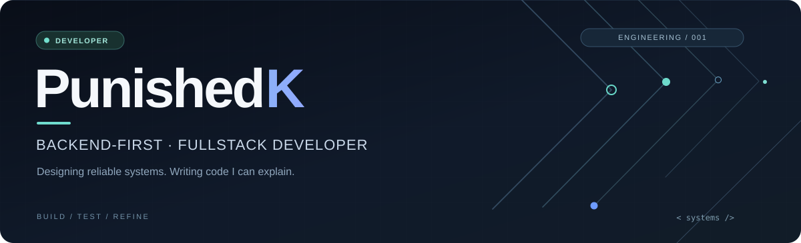
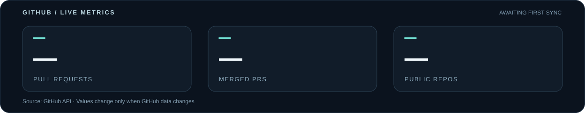

<!-- PunishedK / profile README -->

  

  <strong>Software developer · Backend / Fullstack · Vietnam (UTC+7)</strong> 
  I build practical systems with clear architecture, meaningful tests, and maintainable code.

  <a href="https://github.com/PunishedK?tab=repositories">Repositories</a>
  &nbsp;·&nbsp;
  <a href="https://github.com/pulls?q=is%3Apr+author%3APunishedK">Pull requests</a>
  &nbsp;·&nbsp;
  <a href="https://github.com/PunishedK?tab=overview">Activity</a>

---

### What I focus on

I'm developing toward a **backend-focused fullstack role**, with particular interest in API design, relational data, authentication, authorization, and software reliability. I use AI-assisted development tools, but I aim to understand, review, and test every meaningful change.

**Core stack**

`TypeScript` · `Node.js` · `Express` · `React` · `PostgreSQL` · `Prisma` · `Go` · `Python` · `Docker` · `GitHub Actions`

### Selected work

<table>
<tr>
<td width="50%" valign="top">
  <strong>01 / ApprovalFlow</strong> 
  Fullstack · Backend architecture  
  An expense approval system with multi-stage review, role-based access control, audit trails, API validation, and integration tests.  
  <code>TypeScript</code> <code>Express</code> <code>Prisma</code> <code>PostgreSQL</code>
</td>
<td width="50%" valign="top">
  <strong>02 / BIfrost</strong> 
  Native systems · Local networking  
  An experimental native local file-sharing project, focused on cross-device transfers and a straightforward developer experience.  
  <code>Go</code> <code>Networking</code> <code>Systems</code>
</td>
</tr>
</table>

These projects are under active development; source availability may be limited while they are being tested.

### GitHub, measured

  

Metrics are fetched from GitHub's API. PR counts include repositories accessible to the configured token; no private repository names, code, or links are published. The workflow writes updated files only when the values actually change.

### Contribution graph

<picture>
  <source media="(prefers-color-scheme: dark)" srcset="https://raw.githubusercontent.com/PunishedK/PunishedK/output/github-snake-dark.svg" />
  <source media="(prefers-color-scheme: light)" srcset="https://raw.githubusercontent.com/PunishedK/PunishedK/output/github-snake.svg" />
  
</picture>

Build it with intent. Test it with evidence. Improve it continuously.

