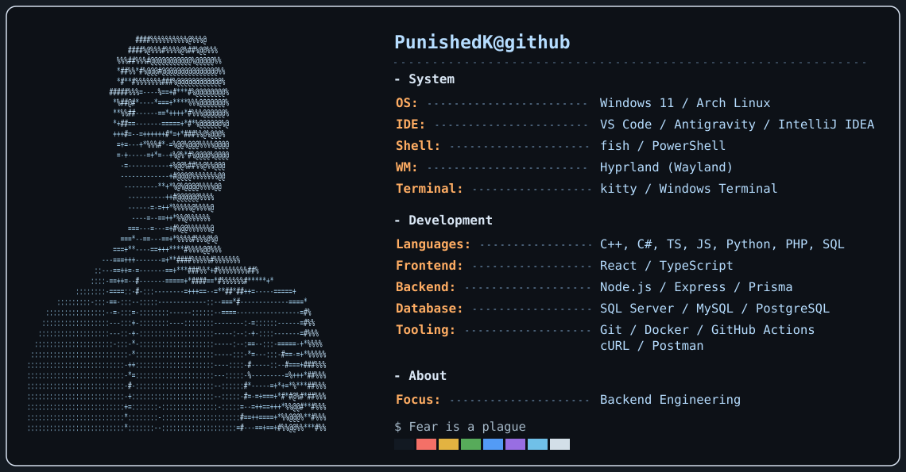
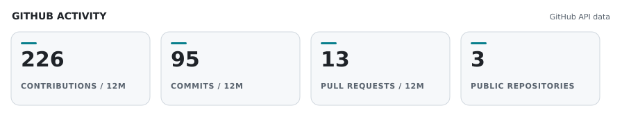

<picture>
  <source media="(prefers-color-scheme: dark)" srcset="./dark_mode.svg">
  <source media="(prefers-color-scheme: light)" srcset="./light_mode.svg">
  
</picture>

<!-- PROFILE_STATS_START -->
### GitHub activity

<picture>
  <source media="(prefers-color-scheme: dark)" srcset="./assets/profile-stats-dark.svg">
  <source media="(prefers-color-scheme: light)" srcset="./assets/profile-stats-light.svg">
  
</picture>
<!-- PROFILE_STATS_END -->

### Contributions

<picture>
  <source media="(prefers-color-scheme: dark)" srcset="./assets/snake-dark.svg">
  <source media="(prefers-color-scheme: light)" srcset="./assets/snake.svg">
  
</picture>
